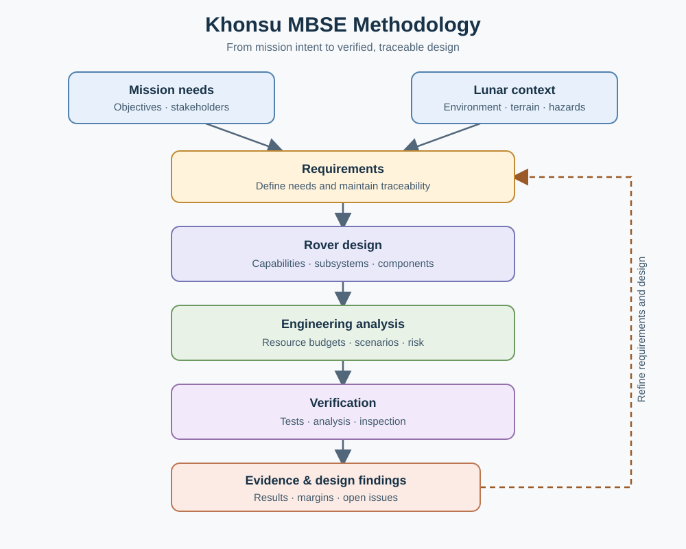

  
   
  <i>Khonsu — An autonomous lunar rover, modeled with OML.</i>

 

## 🌙 Khonsu — Lunar Rover MBSE Method

**🛰️ A model-based systems engineering (MBSE) project for an autonomous lunar surface exploration rover.**

Khonsu is an OML-based modeling method intended to bring the rover's system architecture, requirements, interfaces, resource budgets, operational scenarios, and verification evidence into a coherent, traceable model. The project is inspired by the organization and use of the [Sierra Method](https://github.com/modelware/sierra-method), adapted for the lunar rover domain.

> 🚧 **Project status:** Early development. The repository currently contains the initial Khonsu vocabulary, its base vocabulary, and a vocabulary bundle. Detailed subsystem architecture, requirement and verification models, resource budgets, and analysis scenarios are planned work; they are not yet represented as a complete rover model.

## 🎯 Objectives

- 🧭 Define a clear rover system boundary and subsystem decomposition.
- 🔗 Trace mission and system requirements to subsystem allocations and verification evidence.
- 🔌 Capture interfaces and dependencies between hardware, software, and payloads.
- ⚖️ Represent mass, power, energy, data-rate, memory, and thermal allocations consistently.
- 🛰️ Support analysis of nominal, off-nominal, and safety-related operating scenarios.
- 🧠 Use OML validation and reasoning to identify modeling and logical consistency issues.

## 🧭 Methodology at a glance

Khonsu connects mission intent to rover design, operations, analysis, and verification in one traceable OML model:

  

The methodology is intended to use shared OML vocabulary for consistent definitions, traceability, validation, and reasoning. This diagram shows the intended approach; the current repository contains an initial vocabulary and model starter, while detailed budgets, analysis, and verification evidence remain planned work.

## 🚧 System boundary

### ✅ Included in the intended model

- Rover system and subsystem decomposition.
- Mobility, power, communications, navigation, onboard computing, thermal control, structure, and science payload.
- Functional and performance requirements and their allocation to subsystems.
- Verification activities and links to requirements.
- Preliminary electrical power demand and available-power analysis.

### ❌ Outside the intended model

- Detailed mechanical CAD and finite-element analysis.
- Detailed motor, battery, or thermal hardware simulation.
- Flight-software implementation and autonomous-navigation algorithms.
- High-fidelity lunar terrain simulation.
- Launch-vehicle design and lunar landing-system engineering.

## 👥 Stakeholders

| Stakeholder | Primary concerns |
|---|---|
| 🏛️ Mission sponsor / space agency | Mission objectives, cost effectiveness, schedule, and mission success |
| 📋 Project manager | Unmet requirements, budget overruns, and risks from design changes |
| 🧭 Lead systems engineer | Trade impacts on mass, power, data-rate, and thermal margins |
| 🔧 Subsystem technical leads | Interfaces, dependencies, operating modes, and subsystem resource constraints |
| 🔬 Science team | Mission and payload requirements and mission-data needs |
| 🛡️ Safety and mission assurance lead | Safety-critical traceability, hazards, mitigations, and verification evidence |

## ❓ Model acceptance questions

The model is intended to help answer questions such as:

1. 🌑 During a 50–70-hour lunar-night hibernation, which payload instruments and mobility-computing allocations exceed their heater, battery-power, or energy budgets?
2. 📊 Are mission requirements for mass, dimensions, mobility, payload performance, and mission duration allocated and supported by verification evidence?
3. 🌡️ Which lunar environmental assumptions are represented, including gravity, temperature extremes, vacuum, radiation, and terrain?
4. ⚠️ How are uncertainties, component failures, off-nominal scenarios, hazards, mitigations, and accepted mission risks represented?
5. 📡 After direct-to-Earth (DTE) line of sight is lost, which autonomous path-planning behaviors are allowed, and under what conditions is a Safe-Mode hold required?

> 🎯 These are modeling goals, not claims that the current repository already answers them. Quantitative results require suitable source data, explicit units, assumptions, and analysis rules.

## 🧩 Current model starter

The current OML starter vocabulary includes initial domain concepts such as `Rover`, `Component`, `SubSystem`, `Sensor`, `Actuator`, `Mission`, `Capability`, `Terrain`, `Hazard`, and `State`. It also contains early specializations and scalar properties.

The instance model demonstrates an initial traceability chain from the top-level mission through the traverse, draft requirements, satisfying capabilities, implementing subsystems, and contained components. Requirement thresholds and verification procedures remain preliminary or TBD pending engineering definition.

> 🔍 This vocabulary is a starting point for refinement. Definitions, specializations, units, and property domains should be reviewed as the model evolves. In particular, keep physical components distinct from software functions where that distinction matters to architecture or resource accounting.

## 🗂️ Model navigation and verification

| Model layer | File |
|---|---|
| Base vocabulary | [`src/method/www.modelware.io/khonsu/base.oml`](src/method/www.modelware.io/khonsu/base.oml) |
| Rover vocabulary | [`src/method/www.modelware.io/khonsu/vocabulary.oml`](src/method/www.modelware.io/khonsu/vocabulary.oml) |
| Vocabulary bundle | [`src/method/www.modelware.io/khonsu/bundle.oml`](src/method/www.modelware.io/khonsu/bundle.oml) |
| Rover instance description | [`src/model/oml/khonsu.rover.github.io/instances.oml`](src/model/oml/khonsu.rover.github.io/instances.oml) |
| Description bundle | [`src/model/oml/khonsu.rover.github.io/bundle.oml`](src/model/oml/khonsu.rover.github.io/bundle.oml) |

The description keeps its original namespace and imports; the description bundle includes it and uses the vocabulary bundle.

| Acceptance question | Supporting model elements | Current gap |
|---|---|---|
| Q1 — Lunar-night hibernation budgets | `LunarNightHibernation`, `NavigationSubsystem`, `MobilitySubsystem`, and component mass/power properties | Battery and heater allocations and numeric energy budgets are not modeled; several component values are estimates or TBD. |
| Q2 — Requirement allocation and verification | `Mission1`, `SouthPoleTraverse`, `AutonomousNavigationRequirement`, `MobilityRequirement`, and their satisfaction/implementation relations | Requirement thresholds and verification procedures are preliminary or TBD; evidence is not yet captured. |
| Q3 — Lunar environment | `ShackletonRim`, `ConnectingRidge`, and the terrain and hazard properties | Environmental assumptions and quantified terrain conditions are incomplete or TBD. |
| Q4 — Uncertainty, hazards, mitigations, and risk | `ColdSoak`, `LunarDustContamination`, `RegolithSlipEntrapment`, and `DTELineOfSightLoss` | Likelihood, consequence, mitigation, and uncertainty details are mostly TBD; verification evidence is absent. |
| Q5 — Behavior after DTE link loss | `DTELineOfSightLoss`, `LinkLossCondition`, `LowBatteryCondition`, and `SafeMode` | Conditions link to Safe Mode, but permission for continued autonomous operation after link loss is not yet modeled explicitly. |

The current acceptance questions do not yet require a project-specific inference rule: the modeled traceability and containment links are asserted, while the quantitative assumptions needed for derived budget results are still TBD. Add a domain rule when a defined question needs a derived relationship and its inputs and semantics are specified.

Containment is inverse-functional: each contained element can have at most one container. This matches the current single-owner decomposition; revisit it if shared containment is intended.

Run these commands from the repository root:

| Command | What it does |
|---|---|
| `oml.cmd start` | Starts the OML workspace server. |
| `oml.cmd stop` | Stops the OML workspace server. |
| `oml.cmd list` | Lists active OML servers and their workspaces. |
| `oml.cmd lint` | Checks the OML source for lint errors and warnings. |
| `oml.cmd reason` | Checks the model for logical consistency. |
| `oml.cmd reason --explanation` | Checks consistency and provides an explanation if the model is inconsistent. |
| `oml.cmd reason --owl build/owl` | Checks consistency and writes OWL/Turtle reasoning artifacts under `build\owl`. |

`oml.cmd reason` does not write output files unless `--owl` is supplied.

## 📚 Data sources to incorporate

Planned source material includes:

- 🛰️ NASA VIPER Preliminary Interface Specifications (PIP) and Assembly, Functional and Performance Procedures (AFPP).
- 📋 Master Equipment List (MEL) and subsystem budgets.
- 💻 Software topologies, F´ component information, CCSDS frame definitions, and telemetry mappings.
- ✅ Requirements and verification matrices, including TVAC and hardware-in-the-loop (HIL) documentation.
- 📐 Applicable ECSS guidance for systems engineering, requirements, interfaces, verification, and quality assurance.

> ⚡ Source values should retain provenance and applicable assumptions. Resource comparisons should distinguish power (W) from energy (Wh), and identify operating mode, duration, and duty cycle where relevant.

## 🔗 Reference

- [Sierra Method](https://github.com/modelware/sierra-method) — reference for structuring an OML-based systems-engineering method.
- [openCAESAR OML](https://opencaesar.io/oml/) — language and tooling reference.
- [OML Code](https://www.modelware.io/) — OML authoring and modeling environment.
